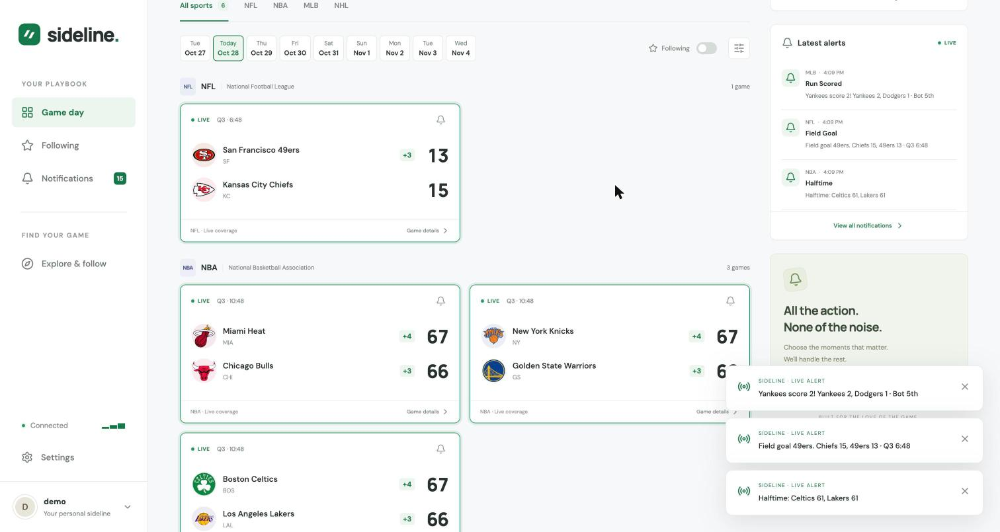
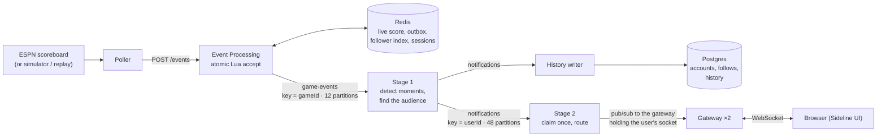
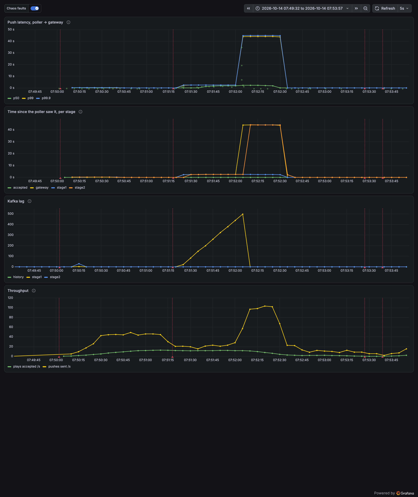

# Sports Notifier

Live sports alerts, built as a distributed system you can kill pieces of. Follow teams, leagues, or single games across the NFL, NBA, MLB, and NHL, choose which moments you care about (a score, a lead change, a close game late, the final), and get a push in the browser the moment it happens.

Eight Java services and a poller on Kubernetes, Kafka between the stages, Redis for the live score, Postgres for accounts. It runs on a laptop (k3d) and on AWS (EKS) from one Helm chart, and a correctness checker proves every user gets every alert exactly once while workers, gateways, and Kafka brokers are being killed.



## Highlights

- **An atomic score.** One Lua script in Redis checks for duplicates, checks game order, and writes the score in one step. Under a 50-event burst for one game, the original course version ended at 43; this one ends at 50 on every run (`EventProcessingBurstTest`).
- **Exactly once, verified.** A checker replays recorded ESPN games to hundreds of synthetic users, recomputes from Kafka and Postgres what each user should get, and compares that with every open socket and every user's history. On EKS: 5,128 expected pushes to 500 users, none missing, duplicated, or out of order.
- **Chaos-tested.** Eight scenarios, each a checked replay with one fault injected mid-game: a SIGKILLed Stage 1 worker, Stage 2 worker, history writer, gateway, or Kafka broker, a gateway rolling restart under load, and Stage 1 or Stage 2 cut off from Kafka for 60 seconds. A scenario passes only if the fault provably landed and the checker still passes.
- **Traced end to end.** One OpenTelemetry trace per play, from the poller through Kafka headers to the WebSocket send, with Grafana dashboards for push latency, Kafka lag, and throughput.
- **AWS on demand.** `make aws-up` builds the whole stack from nothing in about 25 minutes (three nodes in three availability zones, three Kafka brokers, HTTPS); `make aws-down` saves Postgres to S3 and tears it all down in about 15. Accounts survive the round trip.

## How it works



1. **Accept.** The poller turns ESPN's scoreboard into plays. Event Processing runs one Lua script that rejects duplicates and anything older than the game's current state, writes the new state, and puts the play in a per-game outbox, all atomically. Only accepted plays reach Kafka, and only Kafka's confirmation clears the outbox, so a crash can't lose one.
2. **Fan out.** Kafka's `game-events` topic is keyed by game, so each game's plays stay in order on one partition. Stage 1 turns plays into moments (a touchdown, the end of a period, a lead change) and finds every follower from an index of who follows what, rebuilt from Postgres. The most specific follow wins, and each user gets one push per moment.
3. **Deliver.** The `notifications` topic is keyed by user. Stage 2 claims each message in Redis before publishing it, so a Kafka redelivery does nothing, and publishes only to the gateway that holds that user's socket. A separate consumer group writes history to Postgres in batches.

No service elects a leader: a dead worker's partitions move to a survivor through Kafka's own rebalancing, a dead broker is Kafka's leader election, and a dead Redis or Postgres pod is a Kubernetes restart. Every decision and its tradeoffs are in [DESIGN.md](DESIGN.md).

| Service | Role |
|---|---|
| Gateway | HTTP API, WebSocket, sessions, the web UI; two copies |
| Event Processing | Validates plays, runs the accept script, produces to Kafka, retries leftovers |
| Stage 1 / Stage 2 | Moments and audience; delivery to the right gateway (two copies each) |
| History, Notification | Writes and serves notification history (Postgres) |
| User Preference | Accounts, follows, and the follower index |
| Game State | Live scores and the schedule |
| ESPN Poller, Simulator, Replay, Checker | Sources of plays, and the correctness checker |

**Stack:** Java 17, Javalin, Kafka 4 (Strimzi, KRaft), Redis, PostgreSQL 17, Flyway · React 19, TypeScript, Vite, PWA · Kubernetes (k3d, EKS), Helm, Traefik · Terraform, GitHub Actions with OIDC to AWS · OpenTelemetry, Grafana, Tempo, Prometheus · Testcontainers, Vitest, Playwright.

## Evidence

A Stage 1 worker SIGKILLed mid-game: Kafka waits out the session timeout, the surviving worker takes over its partitions, lag drains, and push latency recovers. The checker passed that run with 6,573 pushes. More in [docs/evidence/phase-4-3](docs/evidence/phase-4-3/README.md).



<details>
<summary><b>Everything proven so far, with numbers</b></summary>

- **The score race stays fixed.** In the course project, 50 events for one game sent at once left the score at 43, then 48 after a partial fix, then 50 once the check and the write became one Lua script. `EventProcessingBurstTest` replays that burst on every push. Breaking the script on purpose makes it fail (the score came out 6).
- **Events can't go back in game time.** Each event carries `seq`, one number built from the game's progress (period, clock, outs, score), and the script drops anything not later than what it has. Two pollers running at once, as in a rolling update, send each change once.
- **Following a team covers its whole game.** A Celtics follower gets the Lakers' scores in Lakers–Celtics. The smoke test checks it on a real cluster.
- **Only one signup per username.** Before the fix, 20 of 20 simultaneous signups for one name succeeded; now exactly one does.
- **Internal services aren't reachable from other pods.** The smoke test starts a stranger pod and checks it is refused, for the services and for Kafka.
- **A crash can't lose an accepted play.** The script that accepts a play also writes it to an outbox in Redis, and only Kafka's confirmation clears it; a retry loop sends leftovers. A game has at most one unsent play, so its plays reach Kafka in order. The script enforces that instead of a lock, because a pod that stalls past a lock's timeout can still send an older play after a newer one. Tests crash a pod after accept, run two retry loops at once, slow the broker, and pause it.
- **Each notification arrives once.** Kafka delivers at least once; Stage 2 delivers through one Lua script that claims the message and publishes to the user's gateways in one step, so a redelivery does nothing.
- **Every user gets every push, under faults.** The chaos suite's eight scenarios (crashes of Stage 1, Stage 2, the history writer, a gateway, and the broker; a gateway rolling restart under a request loop with no 5xx allowed; Stage 1 or Stage 2 cut from Kafka for 60 s) all pass on the laptop and in CI. Each is a checker run on ten recorded games at 60× speed.
- **Notifications go only to the gateway holding the socket.** Each gateway listens on its own channel; the smoke test checks an open WebSocket receives the play. Shutting a gateway down closes its sockets with "reconnect now" after removing it from routing.
- **It runs on AWS, from nothing, in about 25 minutes, and back to nothing in about 15.** Three machines in three availability zones, three Kafka brokers (one per zone, every partition copied to all three), HTTPS through a load balancer. On EKS the correctness checker replayed two recorded games to 500 synthetic users at 60× speed: 5,128 expected pushes, none missing, duplicated, or out of order, on 550 sockets and in history. The smoke test passes there too, including the stranger pod being refused.
- **Accounts survive tearing AWS down.** `make aws-down` dumps Postgres to S3 and checks the dump before destroying anything; the next `make aws-up` restores it on Postgres's first boot. An account logged in afterwards with its password, its follow, and all 14 notifications. A corrupt dump makes Postgres crash-loop and never start empty; a restart of a live database never fetches again.
- **A wrong ESPN clock heals.** 60 hours of recorded ESPN data showed the clock running ahead of reality in 2 of 23 NHL games, which would have blocked a game's alerts for minutes. The script now accepts an older-looking play in the same period if it has more points, and a status change at the same score (an end of period, a delay) once it has kept arriving for 10 seconds.

</details>

## Run it locally

Prerequisites: [OrbStack](https://orbstack.dev) or another Docker, `brew install k3d helm kubectl jq`, and Java 17 with Maven for the tests.

```bash
make cluster     # once: a small Kubernetes cluster (k3d) in Docker, plus the Strimzi operator that runs Kafka
make up          # build the image and deploy everything
open http://localhost:8080
make simulate    # play a round of simulated games
make up HELM_ARGS="--set espnPoller.enabled=true"   # the same, with live ESPN data
make down        # delete the cluster (accounts survive in ~/.sportsnotifier/postgres)
```

## Check it

```bash
make test                     # unit and integration tests (a throwaway Redis, Kafka through Testcontainers)
make smoke                    # end to end on the cluster: follows, a live socket, Kafka, network isolation
make check SET=ci SPEED=60    # the correctness checker on two recorded games at 60x
make chaos                    # all eight chaos scenarios (reports in target/chaos/)
make grafana                  # the Pipeline dashboard on localhost:3000
make e2e                      # the web UI in Chromium against the cluster
```

CI runs the Java and web tests, then brings up a throwaway k3d cluster and runs the smoke test, the checker, the trace check, and the browser test on every pull request.

## Run it on AWS

One-time setup (an AWS account with SSO, the CLI, Terraform, and a Cloudflare token) is in [docs/aws-setup.md](docs/aws-setup.md). Then, for each session:

```bash
aws sso login --profile sports
caffeinate -i make aws-up TAG=<image tag>   # ~25 min; read Terraform's plan, then type yes
BASE_URL=https://sports.<domain> KUBE_CONTEXT=sports-notifier-aws make smoke
caffeinate -i make aws-down                 # ~15 min; saves Postgres to S3 first
make aws-status                             # must say "nothing billing"
```

About **$0.45 an hour** while it is up (EKS, three t3.large nodes, the load balancer, disks); under a dollar a month while it is down. A monthly budget emails a warning.

## Where it came from

This started as a graduate Advanced Distributed Systems course project (Yeshiva University, spring 2026): the same idea with Redis doing every job, run from shell scripts on one laptop. The professor's review found a race on the live score (43 instead of 50 under a burst) and some structure problems; both are fixed here. The redesign then gave the event log, the user data, and failure handling each a real tool, and proved the result with a checker while breaking things. [DESIGN.md](DESIGN.md) records every decision along the way.
